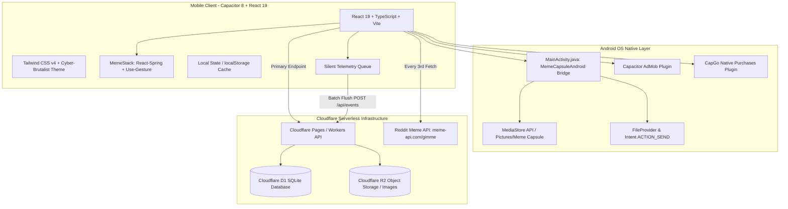

# AI App Context & Engineering Master: Meme Capsule

> **Target Audience:** AI Coding Agents (Claude, Cursor, Hermes, Grok, Copilot, Antigravity, Windsurf) & Collaborating Engineers.  
> **Purpose:** This document is the single, canonical, up-to-date context source for **Meme Capsule**. It details the current project scope, product vision, complete feature inventory, architectural layout, recent progress/commits, client & server state schemas, native Android bridge contracts, design guidelines, and strict engineering guardrails.  
> **Last Updated:** September 2026 (Reflecting commits `3e6ba5a` and `8cccb7b`).

---

## 1. Executive Summary & Project Identity

### What is Meme Capsule?
**Meme Capsule** (`com.meme.capsule`) is a high-octane, mobile-first entertainment application that delivers curated, unpredictable internet memes one at a time with a single tap or swipe. Built with **React 19, TypeScript, and Vite**, and wrapped natively for Android using **Capacitor 8**, it intentionally rejects algorithmic homogenization, infinite feeds, and doomscrolling in favor of a punchy, arcade-style capsule drop experience.

### Core Product Philosophy
- **"Pure memes. Zero algorithm. No doomscrolling."**
- Social feeds (TikTok, Instagram, Reddit, X) trap users in infinite scroll loops filled with sponsored posts and recycled formats.
- Meme Capsule delivers instant, punchy laughs: one tap -> arcade hacker decryption sequence -> instantaneous meme payload -> tactile interactions (swipes, double-taps, reactions, gallery saves, native sharing).

### Current Distribution & Release Status
- **Target Platform:** Android (Native wrapper via Capacitor 8, API level 21+ to 35) + Progressive Web App (PWA).
- **Package ID:** `com.meme.capsule`
- **Play Store Stage:** Google Play Console **Internal Testing (Pre-Production)**.
- **Production Domain:** `https://memecapsule.wtf/`
- **Serverless API Base:** `https://meme-capsule-eww.pages.dev`
- **Monetization Framework:** Google AdMob (Production Ad Unit IDs configured) + In-App Purchases (IAP) via `@capgo/native-purchases` (`remove_ads_forever`).

---

## 2. Technical Stack & Infrastructure Architecture



### Core Technologies
| Domain | Technology / Library | Version | Role / Implementation Details |
| :--- | :--- | :--- | :--- |
| **Frontend Framework** | React | `^19.0.1` | Concurrent mode, hooks, zero unnecessary re-renders |
| **Language** | TypeScript | `~5.8.2` | Strict typings, strict null checks, fully typed payloads |
| **Build Tooling** | Vite | `^6.2.3` | Lightning-fast HMR, optimized production tree-shaking |
| **CSS Styling** | Tailwind CSS | `^4.1.14` | Native `@theme` engine, Neo-Brutalist color tokens & utilities |
| **Gesture & Physics** | `@use-gesture/react` & `@react-spring/web` | `^10.3.1` / `^10.1.2` | Fluid 4-card 3D perspective deck, spring physics, drag threshold |
| **Native Container** | Capacitor | `^8.3.4` | Native Android WebView packaging, cross-platform bridge |
| **Native Java Bridge** | Custom `MainActivity.java` | Native | MediaStore background downloading, FileProvider sharing |
| **Monetization** | `@capacitor-community/admob` | `^8.0.0` | Interstitial ads every 4 memes + rewarded bonus drops |
| **In-App Purchases** | `@capgo/native-purchases` | `^8.6.5` | Google Play Billing `remove_ads_forever` |
| **Iconography** | `lucide-react` | `^0.546.0` | Crisp geometric vector icons |
| **Backend & Edge** | Cloudflare Pages / Workers | Serverless | Edge API endpoints (`/api/random-meme`, `/api/events`, `/api/report`) |
| **Primary Database** | Cloudflare D1 | SQLite Edge | Meme metadata storage & high-volume telemetry events |
| **Media Storage** | Cloudflare R2 | S3-Compatible | Direct CDN image asset hosting |

---

## 3. Complete Feature Inventory & Implementation Status

| Feature | File / Component | Status | Behavior & Specifications |
| :--- | :--- | :--- | :--- |
| **Single-Tap Capsule Drop** | [src/App.tsx](file:///Users/prathampandey/Desktop/zip/src/App.tsx) | `IMPLEMENTED` | Tapping `HIT ME` triggers hacker loader decryption, then pops next meme from queue. |
| **FIFO Prefetch Pipeline** | [src/App.tsx](file:///Users/prathampandey/Desktop/zip/src/App.tsx) | `IMPLEMENTED` | Maintains target buffer of 7 upcoming memes (`PIPELINE_TARGET_SIZE = 7`). Fetches in background and preloads images into browser cache so drops are zero-latency. |
| **Alternating Feed Strategy** | [src/App.tsx](file:///Users/prathampandey/Desktop/zip/src/App.tsx) | `IMPLEMENTED` | Defaults to Cloudflare D1/R2 API (`/api/random-meme`). Every 3rd fetch (`totalMemesViewed % 3 === 0`) queries Reddit (`meme-api.com/gimme`). |
| **NSFW / UGC Safety Filter** | [src/App.tsx](file:///Users/prathampandey/Desktop/zip/src/App.tsx) | `IMPLEMENTED` | Drops Reddit payloads with `nsfw: true` or `spoiler: true`, immediately falling back to curated internal backend. |
| **4-Card 3D Spring Stack** | [src/components/MemeStack.tsx](file:///Users/prathampandey/Desktop/zip/src/components/MemeStack.tsx) | `IMPLEMENTED` | Renders up to 4 stacked cards with staggered 3D perspective, depth offsets, scale down (`1.0 -> 0.95 -> 0.90 -> 0.85`), and neo-brutal drop shadows. |
| **Swipe Gestures** | [src/components/MemeStack.tsx](file:///Users/prathampandey/Desktop/zip/src/components/MemeStack.tsx) | `IMPLEMENTED` | **Swipe Right:** `keep` (fly out right); **Swipe Left:** `skip` (fly out left); **Swipe Up:** `save` (fly out top, saved to Vault). Rubber-band physics with release thresholds. |
| **Double-Tap Reaction & Shake** | [src/components/MemeStack.tsx](file:///Users/prathampandey/Desktop/zip/src/components/MemeStack.tsx) & [src/components/MemeCard.tsx](file:///Users/prathampandey/Desktop/zip/src/components/MemeCard.tsx) | `IMPLEMENTED` | Double-tap detects 2 taps within 320ms, triggers card `animate-shake` haptic simulation and displays random neon text overlays (`DANK!`, `CRINGE!`, `SO REAL`, `GIGA DANK`, `EPIC!`). |
| **Long-Press Gallery Save** | [src/components/MemeStack.tsx](file:///Users/prathampandey/Desktop/zip/src/components/MemeStack.tsx) | `IMPLEMENTED` | Holding pointer for 600ms automatically triggers native gallery download via Java bridge. |
| **Floating Action Rail** | [src/components/MemeCard.tsx](file:///Users/prathampandey/Desktop/zip/src/components/MemeCard.tsx) | `IMPLEMENTED` | Active card features floating action rail on right edge: Like (`Heart`), Quick React (`Smile`), Share (`Share2`), Download (`Download`), Vault (`Bookmark`), Pin to Board (`LayoutGrid`). |
| **Quick Emoji Picker** | [src/components/MemeCard.tsx](file:///Users/prathampandey/Desktop/zip/src/components/MemeCard.tsx) & [src/App.tsx](file:///Users/prathampandey/Desktop/zip/src/App.tsx) | `IMPLEMENTED` | 6 persistent reactions: `💀` (DEAD), `🔥` (FIRE), `😂` (LMAO), `🗿` (BRUH), `❤️` (LOVE), `👑` (KING). Animates floating emoji on select and pins reaction badge to card corner. |
| **UGC Reporting Modal** | [src/ReportModal.tsx](file:///Users/prathampandey/Desktop/zip/src/ReportModal.tsx) | `IMPLEMENTED` | Google Play compliance requirement: Dedicated modal reporting offensive username, hate speech, NSFW, violence, or other violations. Submits to `${ANALYTICS_API_BASE}/api/report`. |
| **Clean Bottom Strip (No Meme IDs)** | [src/components/MemeCard.tsx](file:///Users/prathampandey/Desktop/zip/src/components/MemeCard.tsx) | `IMPLEMENTED` | Shows title and `@author • r/sub` for Reddit memes. Internal R2/DB IDs are strictly hidden for clean presentation. Features red `REPORT` button. |
| **Meme Vault (Favorites)** | [src/App.tsx](file:///Users/prathampandey/Desktop/zip/src/App.tsx) | `IMPLEMENTED` | Searchable local collection of favorited memes with count stats. **Free tier limit:** 20 memes (`FREE_VAULT_LIMIT = 20`). **Pro tier:** Unlimited. |
| **Mood Boards ("Pinned Energy")** | [src/App.tsx](file:///Users/prathampandey/Desktop/zip/src/App.tsx) | `IMPLEMENTED` | Multi-board organization with custom theme colors (`primary`, `secondary`, `tertiary`) and grid views. |
| **Pro Upgrade Tier (IAP)** | [src/ProUpgradeModal.tsx](file:///Users/prathampandey/Desktop/zip/src/ProUpgradeModal.tsx) & [src/App.tsx](file:///Users/prathampandey/Desktop/zip/src/App.tsx) | `IMPLEMENTED` | In-App Purchase via Google Play Billing (`remove_ads_forever`). Unlocks: Zero Ads, Triple Drop Mode, Unlimited Vault, Priority Drops. |
| **AdMob Monetization** | [src/App.tsx](file:///Users/prathampandey/Desktop/zip/src/App.tsx) | `IMPLEMENTED` | Interstitial ad every 4th meme viewed on native Android (`INTERSTITIAL_FREQUENCY = 4`). Rewarded interstitial ads for bonus drops. Automatically bypassed if `isPro === true`. |
| **Daily Streak Counter** | [src/App.tsx](file:///Users/prathampandey/Desktop/zip/src/App.tsx) | `IMPLEMENTED` | Tracks consecutive days opened using `streak_count` and `streak_last_date`. |
| **Dev Joke Ticker** | [src/App.tsx](file:///Users/prathampandey/Desktop/zip/src/App.tsx) | `IMPLEMENTED` | Rotates witty developer jokes every 12 seconds in the subtitle ticker. |
| **Onboarding Modal** | [src/OnboardingModal.tsx](file:///Users/prathampandey/Desktop/zip/src/OnboardingModal.tsx) | `IMPLEMENTED` | 3-slide visual onboarding walkthrough explaining drops, swiping, saving, and Pro features. |
| **Silent Telemetry Pipeline** | [src/analytics/](file:///Users/prathampandey/Desktop/zip/src/analytics) | `IMPLEMENTED` | Batches events (`view`, `like`, `skip`, `keep`, `share`, `download`, `long_view`, `reaction`) in localStorage queue (up to 50 items) and flushes every 30s or on page unload to `POST /api/events`. |
| **Admin Analytics Endpoints** | [functions/api/admin/analytics/](file:///Users/prathampandey/Desktop/zip/functions/api/admin/analytics) & root scripts | `IMPLEMENTED` | Edge functions for aggregating telemetry: `/overview` (ranking top memes by engagement, virality, retention) and `/recalculate`. |

---

## 4. Recent Progress, Commits & Build History

### Commit `8cccb7b` (HEAD -> main)
- **Commit Message:** `fix: remove white top and bottom bars, remove meme ID labels, solidify #131313 theme and update APKs`
- **What Was Solved:**
  1. **System Bars Immersion:** Removed white flash and white navigation/status bars across all Android versions. Enforced `#131313` background across Android `Window`, `statusBarColor`, `navigationBarColor`, `decorView`, `rootView`, and Capacitor `WebView`. Configured `WindowInsetsControllerCompat` to light icons on dark background.
  2. **Theme Unification:** Updated `android/app/src/main/res/values/styles.xml` and `index.html` to guarantee instant `#131313` background rendering before WebKit loads.
  3. **Removed Meme ID Labels:** Completely purged ugly internal database / R2 hash labels from the UI in [src/components/MemeCard.tsx](file:///Users/prathampandey/Desktop/zip/src/components/MemeCard.tsx).
  4. **Updated APK Outputs:** Rebuilt and synced all production and debug Android artifacts.

### Commit `3e6ba5a`
- **Commit Message:** `fix: UI cleanup — hide buttons post-load, remove R2 ID labels, dynamic canvas, remove fresh drop badge, fix white bars`
- **What Was Solved:**
  1. Cleaned up redundant button clusters after meme drops load.
  2. Implemented dynamic aspect ratio canvas: card dimensions dynamically match the natural image aspect ratio (`aspectRatio: memeDimensions ? '${memeDimensions.width} / ${memeDimensions.height}' : '4/3'`) with maximum constraints.
  3. Removed distracting "FRESH DROP" badge.

### Build Outputs in [builds/](file:///Users/prathampandey/Desktop/zip/builds)
- `builds/app-debug.apk` & `builds/meme-capsule-debug.apk` (Latest debug binaries, ~12 MB)
- `builds/meme-capsule-screen-fix-debug.apk` (Bar fix build)
- `builds/meme-capsule-ui-cleanup-debug.apk` (Cleaned UI build)
- `builds/meme-capsule.aab` & `builds/app-release.aab` (Google Play production App Bundles, ~7.8 MB)

---

## 5. File Structure & Component Mapping

```text
/Users/prathampandey/Desktop/zip/
├── AI_APP_CONTEXT.md               <-- Canonical AI Agent Context (this document)
├── APP KNOWLEDGE EXTRACTION...     <-- Knowledge extraction prompt specification
├── app_info.md                     <-- Master product & architecture reference document
├── index.html                      <-- Root HTML entry with viewport-fit=cover & #131313 background
├── package.json                    <-- Dependencies (React 19, Vite 6, Tailwind 4, Capacitor 8)
├── tsconfig.json                   <-- TypeScript strict configuration
├── vite.config.ts                  <-- Vite bundler configuration
├── capacitor.config.json           <-- Capacitor configuration (appId: com.meme.capsule)
│
├── src/
│   ├── main.tsx                    <-- React root mount point
│   ├── App.tsx                     <-- Core state, API fetching, FIFO pipeline, AdMob, tabs, modals
│   ├── index.css                   <-- Tailwind v4 @theme tokens, Anton/Oswald/Chivo fonts, keyframes
│   ├── types.ts                    <-- Core interfaces: Meme, MoodBoard, DismissDecision
│   ├── OnboardingModal.tsx         <-- 3-slide visual onboarding guide
│   ├── ProUpgradeModal.tsx         <-- In-App Purchase modal (remove ads, unlimited vault, triple drops)
│   ├── ReportModal.tsx             <-- UGC policy compliance reporting modal (submits to /api/report)
│   │
│   ├── components/
│   │   ├── MemeStack.tsx           <-- 4-card 3D perspective deck, React-Spring animations, gesture drag
│   │   └── MemeCard.tsx            <-- Individual card, image loader, floating rail, dynamic aspect ratio
│   │
│   └── analytics/
│       ├── index.ts                <-- Analytics module exports & ANALYTICS_API_BASE
│       ├── analyticsTypes.ts       <-- EventType, MemeEvent, EventBatchPayload interfaces
│       ├── deviceId.ts             <-- Persistent anonymous UUID device identifier generator
│       ├── analyticsQueue.ts       <-- LocalStorage buffered event queue (up to 50 events)
│       ├── analyticsFlush.ts       <-- Silent background HTTP batch flush mechanism
│       └── useAnalytics.ts         <-- React hook tracking views, skips, likes, shares, downloads
│
├── android/
│   └── app/src/main/
│       ├── java/com/meme/capsule/
│       │   └── MainActivity.java   <-- BridgeActivity with MemeCapsuleAndroid (MediaStore & Share)
│       └── res/
│           ├── values/styles.xml   <-- Android styles enforcing #131313 status/navigation bars
│           └── drawable*/splash.png<-- Splash screen assets
│
├── functions/                      <-- Cloudflare Pages serverless functions
│   └── api/
│       ├── events.ts               <-- POST /api/events: Receives & batches client telemetry into D1
│       └── admin/analytics/
│           ├── overview.ts         <-- GET /api/admin/analytics/overview: Aggregated performance stats
│           └── recalculate.ts      <-- POST /api/admin/analytics/recalculate: Recalculates scoring ranks
│
├── d1/
│   └── migrations/
│       └── 002_analytics.sql       <-- SQL schema: meme_events, meme_analytics, meme_daily_stats
│
└── builds/                         <-- Generated Android APK and AAB binaries
```

---

## 6. Data Storage, Schemas & Client State

### 1. Client `localStorage` Keys
| Key | Type | Description |
| :--- | :--- | :--- |
| `meme_favorites` | `Meme[]` (JSON) | Saved vault memes. Limited to 20 for free tier; unlimited for Pro. |
| `liked_memes` | `string[]` (JSON) | Array of meme image URLs marked as liked by the user. |
| `meme_mood_boards` | `MoodBoard[]` (JSON) | User-created mood boards with custom color IDs (`primary`, `secondary`, `tertiary`). |
| `meme_reactions` | `Record<string, string>` | Mapping of `memeUrl -> emoji` (e.g. `{"https://...": "💀"}`). |
| `total_memes_viewed`| `number` | Total count of memes presented to user. Triggers AdMob every 4th view. |
| `total_memes_fetched`| `number` | Cumulative fetch attempt counter. |
| `streak_count` | `number` | Current consecutive day streak count. |
| `streak_last_date` | `string` (`YYYY-MM-DD`)| Last recorded active calendar date for streak calculations. |
| `is_pro` | `'true'` \| `null` | Flag indicating active Pro status (IAP unlocked). |
| `meme_device_id` | `string` (UUID) | Anonymous hardware/installation identifier for telemetry. |
| `meme_analytics_queue` | `MemeEvent[]` (JSON) | Buffered telemetry events waiting to be flushed to `/api/events`. |

### 2. Cloudflare D1 Database Tables (`002_analytics.sql`)
1. **`meme_events`:** Individual raw telemetry event logs.
   - Columns: `id`, `meme_id`, `event_type` (`view`, `like`, `unlike`, `share`, `download`, `skip`, `keep`, `long_view`, `re_fetch`, `reaction`), `session_id`, `device_id`, `time_on_meme_ms`, `timestamp`.
2. **`meme_analytics`:** Aggregated performance counters and algorithmic scoring.
   - Columns: `meme_id`, `view_count`, `unique_viewer_count`, `like_count`, `share_count`, `download_count`, `skip_count`, `avg_time_on_meme_ms`, `engagement_score`, `virality_score`, `retention_score`, `trending_score`, `skip_rate`, `like_rate`, `share_rate`.
3. **`meme_daily_stats`:** Daily aggregated rollup for time-series reporting.
4. **`app_global_stats`:** Global platform totals and aggregation timestamps.

---

## 7. Native Android Bridge & System Integration

### Bridge Class: `MainActivity.java`
Registered as JavaScript interface: `window.MemeCapsuleAndroid`

```java
// Registered in onCreate()
bridge.getWebView().addJavascriptInterface(new MemeCapsuleDownloads(this), "MemeCapsuleAndroid");
```

#### 1. `downloadImage(String url, String fileName)`
- **Thread:** Spawns a dedicated background thread (`new Thread(runnable).start()`).
- **Android 10+ (API 29+ / Q):** Utilizes `MediaStore.Images.Media.EXTERNAL_CONTENT_URI` via `ContentResolver`.
  - Sets `RELATIVE_PATH = "Pictures/Meme Capsule"`.
  - Sets `IS_PENDING = 1` while streaming the network response buffer (8KB chunks).
  - Sets `IS_PENDING = 0` upon completion.
  - Requires **zero dangerous runtime permissions** on modern Android.
- **Legacy Fallback (Android <= 9 / P):** Saves directly to `Environment.getExternalStoragePublicDirectory(Environment.DIRECTORY_PICTURES)/Meme Capsule` and sends an `ACTION_MEDIA_SCANNER_SCAN_FILE` broadcast.
- **Feedback:** Displays a native Android Toast (`Saved to Gallery` or `Download failed`).

#### 2. `shareImage(String url, String fileName, String title)`
- Downloads image into app-private cache directory: `context.getCacheDir()/shared_images/`.
- Converts file into content URI using Android `FileProvider`:
  - Authority: `com.meme.capsule.fileprovider`.
- Launches standard Android system chooser:
  ```java
  Intent shareIntent = new Intent(Intent.ACTION_SEND);
  shareIntent.setType(mimeType);
  shareIntent.putExtra(Intent.EXTRA_STREAM, contentUri);
  shareIntent.addFlags(Intent.FLAG_GRANT_READ_URI_PERMISSION);
  activity.startActivity(Intent.createChooser(shareIntent, "Share Meme Capsule image"));
  ```

#### 3. System Bar & UI Color Configuration
To ensure a pure cyber-dark experience without visual glitches:
- Window background: `#131313`.
- Status bar & navigation bar: `#131313` with dark icons disabled (`controller.setAppearanceLightStatusBars(false)`).
- Root content view & WebView background: explicitly set to `#131313` with zero padding.

---

## 8. Styling System & Neo-Brutalist Guidelines

The entire app is styled using **Tailwind CSS v4** with custom tokens defined in [src/index.css](file:///Users/prathampandey/Desktop/zip/src/index.css).

### 1. Palette Tokens
- **Background:** `#131313` (Pitch Cyber Black)
- **Primary Container:** `#9b30ff` (Neon Purple)
- **Secondary Container:** `#f4c300` (Arcade Cyber Gold / Yellow)
- **Tertiary Container:** `#dd0061` (Hot Magenta Pink)
- **Surface Containers:** `#1c1b1b` (Low), `#201f1f` (Standard), `#2a2a2a` (High)
- **Outline / Border:** `#988ca1` (Muted Slate)

### 2. Typography
- **Headlines / Big Labels:** `'Anton', sans-serif` (Ultra-heavy uppercase)
- **Labels, Buttons, Numbers:** `'Oswald', sans-serif` (Condensed industrial mechanical sans)
- **Body & Text:** `'Chivo', sans-serif` (Crisp modern geometric sans)

### 3. Signature Neo-Brutalist UI Rules
- **No Soft Rounded Corners:** Buttons and cards use hard right angles (`rounded-none` or `border-radius: 0px`). Pill shapes are reserved strictly for small status tags.
- **Thick Solid Borders:** Standard borders are `border-[2px]` or `border-[3px]` in black (`#131313`) or neon accents.
- **Offset Drop Shadows:** Sharp, unblurred drop shadows:
  - `shadow-[4px_4px_0px_0px_#f4c300]` (Gold offset)
  - `shadow-[4px_4px_0px_0px_#9b30ff]` (Purple offset)
  - `shadow-[4px_4px_0px_0px_#dd0061]` (Pink offset)
- **Tactile State Shifts:** Buttons depress on click using active transform (`active:translate-x-[2px] active:translate-y-[2px]`).

---

## 9. Critical Rules & Guardrails for AI Agents

When editing, refactoring, or adding features to this codebase, any AI agent **MUST** follow these rules:

> [!IMPORTANT]
> **1. Preserve Native Bridge Compatibility:**
> Never replace or remove calls to `window.MemeCapsuleAndroid.downloadImage` or `window.MemeCapsuleAndroid.shareImage`. Native Android functionality relies on this custom bridge to bypass WebView blob and sandbox restrictions.

> [!WARNING]
> **2. Never Display Internal Database/R2 IDs on the UI:**
> Commits `3e6ba5a` and `8cccb7b` explicitly removed raw ID hashes from the card bottom strip. If `meme.source !== 'Reddit'`, render a clean UI without internal technical labels.

> [!CAUTION]
> **3. Maintain Immersion — Keep #131313 Everywhere:**
> Do NOT set white, light, or transparent backgrounds on `body`, `html`, `#root`, modal backdrops, or Android configuration files. White system bars or background flashes are considered critical regressions.

> [!NOTE]
> **4. Handle CORS Nuances Between Web & Native:**
> - On Android: `CapacitorHttp` is used to bypass CORS restrictions for fetching JSON and images.
> - On Local Web (`npm run dev`): Standard browser CORS applies. Always maintain the fallback pattern established in `fetchJson()`.

> [!IMPORTANT]
> **5. Enforce Google Play Safety Compliance:**
> Meme Capsule fetches third-party memes from Reddit. To comply with Google Play's User Generated Content (UGC) policy:
> - NSFW/spoiler memes are automatically dropped.
> - The `REPORT` button and `ReportModal.tsx` must remain functional and accessible on all displayed memes.

> [!TIP]
> **6. Respect the FIFO Prefetch Queue:**
> When altering meme navigation or animations, do not bypass `memeQueue` or `fillPipeline`. Immediate, lag-free card drops depend on background prefetching and image preloading.

---

## 10. Development Commands & Operational Workflows

### 1. Local Development
```bash
# Install dependencies
npm install

# Run local Vite dev server (host: 0.0.0.0, port: 3000)
npm run dev
```

### 2. Type Checking & Verification
```bash
# Verify TypeScript typings with zero emit
npm run lint
```

### 3. Android Build & Sync
```bash
# Build web bundle and sync native Android project
npm run build:android

# Open native Android project in Android Studio
npx cap open android
```

### 4. Direct Gradle APK Compilation
```bash
# Navigate to android directory and compile debug APK
cd android && ./gradlew assembleDebug

# Compile release App Bundle (AAB) for Google Play
cd android && ./gradlew bundleRelease
```
