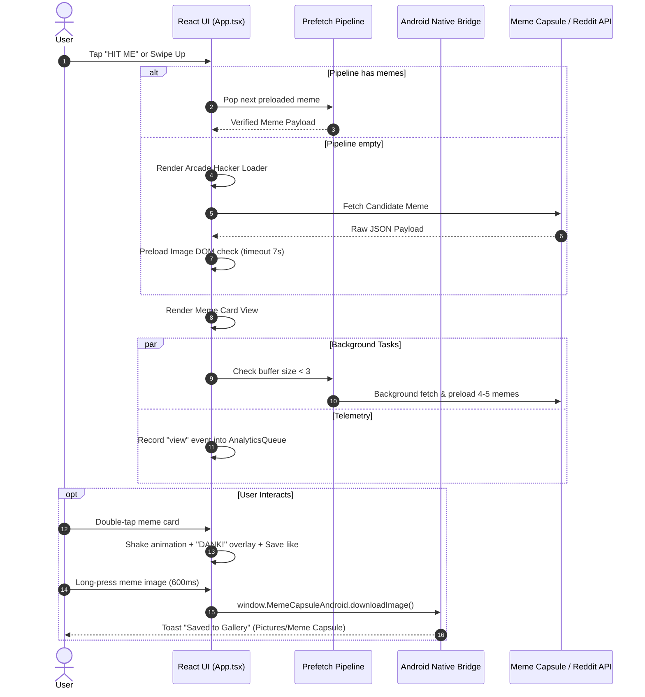

# MASTER KNOWLEDGE DOCUMENT: MEME CAPSULE
**Comprehensive Product, Architecture, Engineering, and Operational Reference**

---

## DOCUMENT METADATA
- **Project / App Name:** MEME CAPSULE
- **Android Package ID:** `com.meme.capsule`
- **Current Version:** `1.0.0` (Internal Testing / Pre-Production)
- **Primary Domain & Landing Site:** `https://memecapsule.wtf/`
- **Serverless API Base:** `https://meme-capsule-eww.pages.dev`
- **Google Play Category:** Entertainment / Casual
- **Target Platform:** Android (Native Wrapper via Capacitor 8, API Level 21+ to 35) + Progressive Web Application (PWA)
- **Document Status:** Master Reference & Canonical Source of Truth

---

## TABLE OF CONTENTS

1. [Project at a Glance — Core Product Questions](#1-project-at-a-glance--core-product-questions)
2. [Executive Project Overview](#2-executive-project-overview)
3. [Product Identity, Philosophy & Vision](#3-product-identity-philosophy--vision)
4. [Target Users, Personas & Use Cases](#4-target-users-personas--use-cases)
5. [Complete Feature Inventory](#5-complete-feature-inventory)
6. [User Experience & Application Workflows](#6-user-experience--application-workflows)
7. [Technical Architecture Overview](#7-technical-architecture-overview)
8. [Frontend Architecture & UI Engineering](#8-frontend-architecture--ui-engineering)
9. [Android Native Bridge & Packaging](#9-android-native-bridge--packaging)
10. [Backend Architecture & Cloudflare Serverless](#10-backend-architecture--cloudflare-serverless)
11. [Database, Schemas & Data Modeling](#11-database-schemas--data-modeling)
12. [APIs, Network Protocols & External Integrations](#12-apis-network-protocols--external-integrations)
13. [AI / Machine Learning Systems Analysis](#13-ai--machine-learning-systems-analysis)
14. [Security, Privacy, Content Moderation & Permissions](#14-security-privacy-content-moderation--permissions)
15. [Admin, Analytics & Telemetry Pipeline](#15-admin-analytics--telemetry-pipeline)
16. [UI/UX Design System & Cyber-Brutalist Aesthetic](#16-uiux-design-system--cyber-brutalist-aesthetic)
17. [Project Terminology & Domain Glossary](#17-project-terminology--domain-glossary)
18. [Current Implementation Status Matrix](#18-current-implementation-status-matrix)
19. [Roadmap, Planned Features & Technical Debt](#19-roadmap-planned-features--technical-debt)
20. [Known Issues, Bugs, Limitations & Open Questions](#20-known-issues-bugs-limitations--open-questions)
21. [Development History, Debugging Log & Architectural Decisions](#21-development-history-debugging-log--architectural-decisions)
22. [Product Differentiation & Key Characteristics](#22-product-differentiation--key-characteristics)
23. [Content-Ready Project Descriptions](#23-content-ready-project-descriptions)
24. [AI-Handoff & Portable Agent Context](#24-ai-handoff--portable-agent-context)
25. [Final Master Summary](#25-final-master-summary)

---

## 1. PROJECT AT A GLANCE — CORE PRODUCT QUESTIONS

> [!NOTE]
> This section is specifically organized so that any collaborator, stakeholder, or AI coding assistant can extract the core working context of Meme Capsule immediately without parsing the entire manual.

### 1. What is Meme Capsule?
**Meme Capsule** is a high-octane, mobile-first entertainment application that delivers curated, unpredictable internet memes one at a time with a single tap. Built with React 19, TypeScript, and Vite, and packaged natively for Android using Capacitor 8, it rejects algorithmic feeds and infinite scrolling in favor of a punchy, arcade-style capsule drop experience.

### 2. Why does Meme Capsule exist?
Modern social feeds (TikTok, Instagram Reels, Reddit, X) have become bloated, repetitive, and algorithmically homogenized. Users spend minutes mindless scrolling through recycled videos, brand promotions, and engagement bait just to find a single laugh. Meme Capsule exists to restore the raw, chaotic joy of discovering great memes instantly: **No algorithm. No infinite feed. No doomscrolling. Pure internet culture.**

### 3. What problem is it trying to solve?
- **Algorithmic Fatigue:** Recommendation algorithms trap users in repetitive bubbles showing the same recycled formats.
- **Doomscrolling Waste:** Infinite feeds encourage mindless scrolling rather than discrete, satisfying entertainment moments.
- **Friction in Saving/Sharing:** Finding, cleanly saving, and sending memes to friends on messaging apps (like WhatsApp) typically requires screenshots, cropping, or dealing with external watermarks.

### 4. Who is Meme Capsule for?
- **Digital Natives & Meme Connoisseurs (Gen Z & Millennials):** Users who live in group chats, appreciate unhinged web humor, and want high-quality meme ammunition to send friends.
- **Micro-Break Seekers:** Commuters, students, and professionals looking for a 30-second dopamine hit between tasks rather than a 45-minute social media rabbit hole.
- **Meme Curators & Hoarders:** Users who organize personal collections into categorized mood boards for every vibe and scenario.

### 5. How does Meme Capsule work?
The user opens the app to a bold, arcade-like interface featuring a prominent **`HIT ME`** button. Tapping the button triggers a retro-futuristic hacker decryption sequence while the client queries either the custom Meme Capsule Cloudflare D1/R2 repository or an alternating Reddit meme relay. The fetched image is validated, preloaded, and displayed in an interactive card where the user can double-tap to react, save to their local **Meme Vault**, pin to custom **Mood Boards**, download directly to their Android gallery, or share via the native Android share sheet.

### 6. What are all of its major features?
- **Single-Tap Capsule Drop:** Instantaneous meme delivery powered by an alternating Cloudflare D1 / Reddit relay.
- **FIFO Prefetch Pipeline & Swiping:** Vertical swipe gestures (Swipe Up for next drop, Swipe Down for session history) backed by an active 7-meme background prefetch buffer.
- **Arcade Hacker Loader:** Engaging terminal logs and erratic countdown timers that make latency feel like a gameplay mechanic.
- **Meme Vault (Favorites):** Local SQLite/localStorage collection of favorited memes with real-time text search and full offline management.
- **Custom Mood Boards ("Pinned Energy"):** Multi-board organization allowing users to categorize memes into custom themed collections with distinct color identities.
- **Double-Tap & Quick Emoji Reactions:** Dynamic visual overlays (`DANK!`, `CRINGE!`, `SO REAL`) and 6 selectable persistent emoji reactions (`💀`, `🔥`, `😂`, `🗿`, `❤️`, `👑`).
- **Native Android MediaStore Integration:** Direct, permissionless image saving into `Pictures/Meme Capsule` via a custom Java bridge, bypassing browser blob limitations.
- **Native Intent Chooser Sharing:** System-level image caching and `FileProvider` sharing directly to messaging apps.
- **Streak Tracker & Rank Gamification:** Consecutive day usage counter with status badges (from `🌱 FRESH` to `🏆 MEME GOD`).
- **Capsule Multi-Drop / Triple Drop:** Pro and rewarded capability to unpack 3 memes simultaneously in a swipeable mini-gallery.
- **Content Reporting & Local Blacklisting:** Granular safety report modal that instantly removes and permanently blacklists inappropriate memes locally while transmitting moderation telemetry.
- **In-App Purchase Pro Tier (₹99 One-Time):** Google Play Billing integration unlocking zero ads forever, unlimited vault storage, priority drops, and permanent Triple Drop access.
- **Silent Analytics Telemetry:** Background event tracking (views, skips, time on meme, likes, shares, downloads) aggregated via Cloudflare Pages and D1.

### 7. How is it technically built?
- **Frontend:** React 19 (Hooks), TypeScript 5.8, Vite 6.2, Tailwind CSS v4 (`@tailwindcss/vite`), Lucide React icons.
- **Mobile Container:** Capacitor 8 (`@capacitor/core`, `@capacitor/android`, `@capacitor/share`, `@capacitor-community/admob`, `@capgo/native-purchases`).
- **Native Android Layer:** Custom `MainActivity.java` extending `BridgeActivity`, exposing `MemeCapsuleAndroid` via WebKit `addJavascriptInterface` for MediaStore and FileProvider file operations.
- **Backend & Ingestion:** Cloudflare Pages Functions, Cloudflare D1 (SQLite database), Cloudflare R2 (object storage), Cloudflare KV (analytics response caching).
- **Secondary Upstream:** Public Reddit API gateway (`https://meme-api.com/gimme`).

### 8. How do users interact with it?
Interaction is tactile, punchy, and haptic-inspired:
- **Tapping:** Massive primary buttons (`HIT ME`, `BONUS DROP`, `TRIPLE DROP`) that visually depress and shed their offset shadows on active click.
- **Swiping:** Mobile vertical swipe up/down gestures with real-time CSS scale and translation damping.
- **Double-Tapping:** Rapid double-tap on the meme card triggers an animated shaking feedback (`animate-shake`) and floating text reactions.
- **Long-Pressing:** Holding down on the meme image for 600ms automatically downloads it to the phone gallery.

### 9. How does its backend work?
The backend is completely serverless. When the app requests a meme, it calls Cloudflare Pages Functions (`/api/random-meme`) backed by Cloudflare D1. For telemetry, the frontend enqueues client actions into a circular buffer and flushes them in batches to `/api/events`. A background recalculation engine aggregates raw events into normalized ranking tables (`meme_analytics`, `app_global_stats`, `meme_daily_stats`), calculating engagement, virality, and skip scores.

### 10. How does its AI/ML system work, if applicable?
**Meme Capsule intentionally does NOT use an AI recommendation algorithm to determine what users see.** The core product philosophy is anti-algorithmic serendipity. While the repository contains Google AI Studio artifacts and `@google/genai` in `package.json` (inherited from the initial project scaffolding), generative AI is not currently used in the live user experience.

### 11. What are its most important concepts and workflows?
- **Capsule Drop:** The discrete act of requesting and rendering one meme.
- **Alternating Strategy:** 2 custom backend drops followed by 1 Reddit drop (every 3rd view), with automatic safety fallbacks.
- **Meme Vault vs. Mood Boards:** Vault is the flat master list of favorites; Mood Boards are user-curated thematic binders.
- **Prefetch Pipeline:** An invisible buffer maintaining up to 7 verified images in memory so swiping feels instantaneous.

### 12. What is currently implemented vs. planned?
- **Implemented:** Full React 19 UI, Neo-Brutalist styling, Dual-source meme fetching, FIFO Prefetching, Vertical touch swiping, Native Android MediaStore download bridge, Native FileProvider share bridge, AdMob Interstitials and Rewarded Ads, Native In-App Purchases (`@capgo/native-purchases`), Mood Boards, Emoji Reactions, Streaks, Content Reporting & Local Blacklisting, Silent Event Telemetry (`/api/events`).
- **Backend Complete but Admin UI Unlinked:** Cloudflare D1 analytics aggregation and endpoints (`/api/admin/analytics/overview`, `rankings`, `trends`, `insights`) are implemented, but the PIN-gated Admin Dashboard tab is not linked into the frontend navigation.
- **Planned:** Server-side user accounts/cloud sync, user-submitted meme uploads, social collaborative mood boards, production Google Play rollout.

### 13. What makes the application different or distinctive?
Meme Capsule combines an aggressive, high-energy **Neo-Brutalist Arcade** aesthetic (heavy uppercase Anton typography, neon purple/yellow/hot pink palette, chunky 4px borders, hard drop shadows) with an uncompromising **zero-algorithm philosophy**. It transforms passive content browsing into an active, tactile arcade drop.

### 14. What terminology or project-specific concepts should someone understand before working on it?
- **MemeCapsuleAndroid:** The native Java interface injected into the WebView to handle Android 10+ MediaStore permissions cleanly.
- **Pipeline:** The client-side array (`memeQueue`) preloading images in advance.
- **D1 Vault:** The internal Cloudflare D1 storage bucket holding curated memes.
- **Erratic Counter:** A CSS `@keyframes` trick that cycles random numbers to simulate decryption without consuming CPU JS timers.

---

## 2. EXECUTIVE PROJECT OVERVIEW

Meme Capsule is a specialized Android entertainment app developed to counteract the fatigue induced by modern infinite-scroll social networks. Rather than indexing user data to build an algorithmic engagement trap, Meme Capsule curates internet humor and distributes it in discrete, high-impact "drops."

```
+-------------------------------------------------------------------------+
|                              MEME CAPSULE                               |
|                  "One Tap. One Meme. Pure Chaos."                       |
+-------------------------------------------------------------------------+
|  [ FRONTEND - REACT 19 ]      [ NATIVE BRIDGE ]      [ BACKEND - D1/R2 ]|
|  - Neo-Brutalist Arcade UI    - Capacitor 8 Android  - Cloudflare Pages |
|  - FIFO Preload Pipeline      - Java MediaStore API  - D1 SQLite Tables |
|  - Vertical Swipe Engine      - FileProvider Shares  - R2 Image Storage |
|  - Vault & Mood Boards        - Native Google Billing- Batch Telemetry  |
+-------------------------------------------------------------------------+
```

### One-Paragraph Overview
> **Meme Capsule** is a mobile-first, arcade-styled meme discovery application for Android that provides instant, hand-picked internet comedy at the push of a single button. Designed with a vibrant cyber-brutalist aesthetic, the app replaces monotonous feed scrolling with a high-energy "capsule drop" loop, combining seamless vertical swipe navigation, native Android gallery downloads, direct social sharing, customizable mood boards, and streak gamification, all backed by a resilient serverless architecture on Cloudflare.

---

## 3. PRODUCT IDENTITY, PHILOSOPHY & VISION

### 3.1 The Product Philosophy
1. **The Anti-Feed Movement:** Infinite scrolling promotes mindless consumption where quantity overrides quality. By limiting the interface to one meme at a time with deliberate transitions, every meme commands full attention.
2. **Serendipity Over Algorithmic Traps:** Algorithms optimize for outrage, controversy, and familiarity. Meme Capsule optimizes for surprise. Every drop is an unpredictable collision with the internet's humor archive.
3. **Tactile Digital Physicality:** Modern mobile apps feel sterile, flat, and frictionless. Meme Capsule embraces heavy borders, hard offset shadows, simulated mechanical buttons, terminal logs, and haptic shakes that feel like operating a physical arcade vending machine.
4. **Frictionless Ownership:** Great memes are meant to be kept and shared. The app treats memes as collectible assets that can be organized into personal boards and saved directly into the phone's native gallery with zero watermarks.

### 3.2 Brand Voice & Identity
- **Tagline:** "One Tap. One Meme. Pure Chaos." / "Your Daily Dose of Unhinged."
- **Tone:** Unapologetic, irreverent, internet-native, high-energy, and witty.
- **Colors:** Deep Pitch Cyber Black (`#131313`), Neon Purple (`#9b30ff`), Arcade Gold/Yellow (`#f4c300`), and Hot Magenta Pink (`#dd0061`).

---

## 4. TARGET USERS, PERSONAS & USE CASES

### 4.1 Primary Personas
- **The Group Chat Artillery Commander (Age 16–26):**
  - *Goal:* Needs the freshest, least-recycled memes to win group chats on WhatsApp, Discord, or Instagram DM.
  - *Pain Point:* Searching Reddit or Instagram yields memes everyone in the chat saw three days ago.
  - *Behavior:* Uses the `SHARE` button directly or long-presses to download to device gallery.
- **The Micro-Break Commuter (Age 20–35):**
  - *Goal:* Wants 2–5 minutes of genuine amusement while riding the metro or waiting in line.
  - *Pain Point:* Opening Instagram or TikTok results in getting sucked in for 45 minutes or seeing boring sponsored content.
  - *Behavior:* Taps `HIT ME` 10 to 15 times, laughs, and closes the app.
- **The Mood Board Aesthetic Curator (Age 18–28):**
  - *Goal:* Collects memes that represent very specific vibes, life situations, or tech jokes.
  - *Pain Point:* Saved folders on social apps mix memes with recipes, travel clips, and news.
  - *Behavior:* Creates boards like "3 AM TECH DREAD" or "MIDTERMS VIBE" and pins favorites.

---

## 5. COMPLETE FEATURE INVENTORY

### 5.1 Core Features

#### Feature 5.1.1: The "HIT ME" Primary Drop Engine
- **Description:** The central interactive mechanism of the application. Tapping the prominent yellow button transitions the user from the waiting screen into the loading and viewing cycle.
- **Backend Relay:** Alternates 2 backend drops from Cloudflare D1/R2 with 1 drop from Reddit (`https://meme-api.com/gimme`).
- **Validation Pipeline:** Before presenting the meme, an image preloader verifies that the URL resolves, is a supported image MIME type (filtering `.gifv`, `v.redd.it`, and gallery links), and successfully loads within a 7-second timeout.
- **Status:** **IMPLEMENTED**

#### Feature 5.1.2: FIFO Background Prefetch Pipeline & Swiping
- **Description:** A background queue management system (`PIPELINE_TARGET_SIZE = 7`) that pre-fetches and preloads candidate memes ahead of time.
- **Gestures:** Users can swipe vertically on the meme card.
  - *Swipe Up:* Discards current meme, advances to the next preloaded meme in the queue, and triggers background queue replenishment.
  - *Swipe Down:* Re-renders the immediately preceding meme from `memeHistory`.
- **Status:** **IMPLEMENTED**

#### Feature 5.1.3: Arcade Hacker Loading Console
- **Description:** An interactive loading transition featuring randomized diagnostic status logs ("HARVESTING CLOUDFLARE D1 SHARDS...", "FILTERING CRINGE FREQUENCIES..."), a neo-brutalist shimmer bar, and an erratic CSS countdown animation.
- **Status:** **IMPLEMENTED**

#### Feature 5.1.4: Meme Vault (Local Favorites Archive)
- **Description:** A dedicated tab allowing users to view, search, and manage memes they have bookmarked.
- **Capabilities:** Instant real-time title search filtering, direct per-card download, direct per-card share, pin-to-board shortcut, and deletion.
- **Storage Limits:** Free users are capped at 20 saved memes; Pro users enjoy unlimited capacity.
- **Status:** **IMPLEMENTED**

#### Feature 5.1.5: Mood Boards ("Pinned Energy")
- **Description:** Thematic organizational binders allowing users to curate distinct sub-collections.
- **Capabilities:** Create boards with custom titles and color themes (`primary`, `secondary`, `tertiary`), toggle memes on/off boards from either the discovery view or the Vault, view pinned memes in a multi-column masonry layout, and delete boards.
- **Status:** **IMPLEMENTED**

#### Feature 5.1.6: Double-Tap & Quick Emoji Reactions
- **Description:** Visual feedback and categorization system on meme cards.
  - *Double-Tap:* Shakes the card and triggers a retro skewed text stamp (`DANK!`, `CRINGE!`, `SO REAL`, etc.).
  - *Emoji Bar:* Quick-access tray with 6 emojis (`💀 DEAD`, `🔥 FIRE`, `😂 LMAO`, `🗿 BRUH`, `❤️ LOVE`, `👑 KING`). Selecting an emoji pins a badge to the meme card and sends a telemetry event.
- **Status:** **IMPLEMENTED**

#### Feature 5.1.7: Dual-Path Native Image Download
- **Description:** Reliable gallery saving regardless of environment.
  - *Native Android:* Uses `window.MemeCapsuleAndroid.downloadImage()` which leverages Android's `MediaStore` API to insert cleanly into `Pictures/Meme Capsule` without requiring deprecated storage write permissions.
  - *Web / PWA:* Programmatic `Blob` URL generation and anchor click triggering.
- **Status:** **IMPLEMENTED**

#### Feature 5.1.8: Dual-Path Native Social Sharing
- **Description:** Effortless image sharing directly to WhatsApp, Telegram, X, etc.
  - *Native Android:* Downloads image to the app's internal cache (`shared_images/`), retrieves a secure URI via Android `FileProvider`, and opens the system `Intent.ACTION_SEND` chooser.
  - *Web / PWA:* Attempts Web Share API; falls back to copying the direct meme URL to clipboard.
- **Status:** **IMPLEMENTED**

#### Feature 5.1.9: Gamified Daily Streaks
- **Description:** Tracks consecutive days of app usage with persistent local timestamps.
- **Status Badges:** `🌱 FRESH` (1–2 days), `⚡ RISING` (3–6 days), `🔥 ON FIRE` (7–29 days), `👑 LEGENDARY` (30–99 days), `🏆 MEME GOD` (100+ days).
- **Status:** **IMPLEMENTED**

#### Feature 5.1.10: Capsule Multi-Drop / Triple Drop
- **Description:** Pack-opening style mechanic where 3 memes are pulled concurrently using `Promise.all`. The user navigates between the 3 drops via indicator pips.
- **Access:** Reserved for Pro users or unlocked via rewarded interstitial ads.
- **Status:** **IMPLEMENTED**

#### Feature 5.1.11: Content Safety Reporting & Local Blacklist
- **Description:** A dedicated reporting dialog (`ReportModal.tsx`) with categorized flags (Hate Speech, NSFW, Offensive Author, Violence, Other).
- **Local Enforcement:** Flagging a meme immediately appends its URL to `reported_memes` in `localStorage`, removes it from the user's Vault if present, skips to the next meme, and blocks it from ever loading again on that device.
- **Remote Telemetry:** Submits a POST payload to `/api/report` for backend review.
- **Status:** **IMPLEMENTED**

#### Feature 5.1.12: Monetization (AdMob & Native In-App Purchases)
- **AdMob Interstitials:** Shows an interstitial ad every 4th meme viewed on native Android (bypassed for Pro).
- **AdMob Rewarded Ads:** Provides a "BONUS DROP" for non-Pro users upon watching an ad.
- **Pro Tier (`₹99` One-Time):** Handled via `@capgo/native-purchases` against Google Play Billing product ID `remove_ads_forever`. Unlocks zero ads, unlimited vault, and Triple Drop mode. Includes automatic purchase restoration.
- **Status:** **IMPLEMENTED**

#### Feature 5.1.13: Silent Analytics Telemetry
- **Description:** Client-side event buffering (`AnalyticsQueue`) that tracks user interactions without third-party tracking scripts.
- **Batched Ingest:** Flushes queued events (`view`, `like`, `unlike`, `share`, `download`, `skip`, `long_view`, `reaction`) to Cloudflare Pages `/api/events`.
- **Status:** **IMPLEMENTED**

#### Feature 5.1.14: Admin Analytics & Aggregation Engine
- **Description:** Cloudflare Pages functions and D1 database queries that compute global metrics, top leaderboards, virality scores, and retention analytics.
- **Status:** **PARTIALLY IMPLEMENTED** (Backend tables, migration, and API endpoints exist; frontend admin dashboard tab is not active in `App.tsx`).

---

## 6. USER EXPERIENCE & APPLICATION WORKFLOWS

### 6.1 The Core Discovery Loop



### 6.2 Workflow: The Pro Upgrade Flow
1. User taps **`GO PRO`** in the top navigation or attempts to exceed the 20-meme Vault limit.
2. `ProUpgradeModal.tsx` opens with neon styling, feature checklist, and the ₹99 one-time price tag.
3. User taps **`BECOME A GIGACHAD`**.
4. The app checks `Capacitor.isNativePlatform()`. If native, it invokes `@capgo/native-purchases`:
   - Checks billing support via `isBillingSupported()`.
   - Validates `productIdentifiers: ['remove_ads_forever']`.
   - Launches the native Google Play bottom sheet payment dialog.
5. On transaction completion:
   - Sets `is_pro` to `'true'` in `localStorage`.
   - Closes modal, displays "💎 PRO UNLOCKED!" toast.
   - Disables all future AdMob interstitial triggers and unlocks Triple Drop.

---

## 7. TECHNICAL ARCHITECTURE OVERVIEW

Meme Capsule uses a modern decoupled architecture: a single-page React application hosted on the edge, wrapped in an Android native container, communicating with serverless cloud functions and upstream media relays.

```
+-------------------------------------------------------------------------------+
|                             CLIENT ARCHITECTURE                               |
|                                                                               |
|  +------------------------+      +------------------+      +---------------+  |
|  |       React 19         | <--> |  AnalyticsQueue  | ---> | Preload Buffer|  |
|  |  (App.tsx / Modals)    |      |  (Circular 200)  |      | (7 Candidates)|  |
|  +------------------------+      +------------------+      +---------------+  |
|              |                                                                |
|              v (Capacitor JavaScript Bridge)                                  |
|  +-------------------------------------------------------------------------+  |
|  |                     Android Native (MainActivity.java)                  |  |
|  |  - WebKit JavascriptInterface ("MemeCapsuleAndroid")                    |  |
|  |  - MediaStore API (Scoped Storage Android 10+ Pictures/Meme Capsule)     |  |
|  |  - FileProvider Caching & Intent.ACTION_SEND System Chooser             |  |
|  |  - Google Play Billing Plugin (@capgo/native-purchases)                 |  |
|  |  - Google Mobile Ads SDK (@capacitor-community/admob)                   |  |
|  +-------------------------------------------------------------------------+  |
+-------------------------------------------------------------------------------+
                                       |
                   HTTP / REST Requests (JSON)
                                       v
+-------------------------------------------------------------------------------+
|                            SERVERLESS BACKEND                                 |
|                                                                               |
|  +-------------------------------------------------------------------------+  |
|  |               Cloudflare Pages Functions (Edge Workers)                 |  |
|  |  - /api/random-meme             : Curated vault delivery                |  |
|  |  - /api/events                  : Batched silent telemetry ingest       |  |
|  |  - /api/report                  : User content moderation submissions   |  |
|  |  - /api/admin/analytics/*       : Aggregation, rankings, trends         |  |
|  +-------------------------------------------------------------------------+  |
|              |                                            |                   |
|              v                                            v                   |
|  +-----------------------+                    +-----------------------+       |
|  |  Cloudflare D1 (SQL)  |                    |  Cloudflare R2 Bucket |       |
|  |  - meme_events        |                    |  - Curated WebP/JPG   |       |
|  |  - meme_analytics     |                    |    Assets             |       |
|  |  - app_global_stats   |                    +-----------------------+       |
|  +-----------------------+                                                    |
+-------------------------------------------------------------------------------+
                                       |
                         External Upstream Relay (1 of 3)
                                       v
                     +-----------------------------------+
                     | Reddit Meme API (meme-api.com)    |
                     +-----------------------------------+
```

---

## 8. FRONTEND ARCHITECTURE & UI ENGINEERING

### 8.1 Technology Stack
- **Framework:** React 19.0.1
- **Language:** TypeScript 5.8.2 (Strict typing across payloads)
- **Build System:** Vite 6.2.3 with `@tailwindcss/vite`
- **Styling:** Tailwind CSS v4 with custom `@theme` tokens in `src/index.css`
- **Iconography:** Lucide React (`lucide-react` v0.546.0)

### 8.2 Component & Directory Breakdown
- **`src/App.tsx` (82 KB):** Central application controller. Manages state for the active tab (`home`, `favorites`, `boards`), the screen view state (`waiting`, `loading`, `viewing`, `error`), the meme object, touch swipe vectors, local favorites, mood boards, streaks, and AdMob events.
- **`src/OnboardingModal.tsx`:** 3-step carousel modal introducing the app's zero-algorithm value proposition and swipe gestures.
- **`src/ProUpgradeModal.tsx`:** Neo-brutalist modal handling Google Play in-app purchase flow and feature presentation.
- **`src/ReportModal.tsx`:** Content moderation dialog for user safety compliance.
- **`src/analytics/`:** Standalone telemetry module:
  - `deviceId.ts`: Persistent SHA-256 device identifier generator.
  - `analyticsTypes.ts`: Strict TypeScript interfaces for event payloads.
  - `analyticsQueue.ts`: Circular memory buffer holding up to 200 events.
  - `analyticsFlush.ts`: Edge-flushing logic utilizing `CapacitorHttp` (native) or `fetch` (web).
  - `useAnalytics.ts`: React hook managing automated flush timers (60s), visibility listeners, and skip/long-view heuristics.

### 8.3 State Management & Local Storage Keys
All state persistence is handled locally via browser `localStorage`:
| Storage Key | Data Type | Purpose |
|---|---|---|
| `meme_favorites` | `JSON Array<Meme>` | Full records of memes bookmarked to the user's Vault. |
| `meme_mood_boards` | `JSON Array<MoodBoard>` | User-created custom mood board collections and pinned URLs. |
| `liked_memes` | `JSON Array<string>` | URLs of memes that the user has liked via heart or double-tap. |
| `meme_reactions` | `JSON Record<string, string>` | Mapping of meme URLs to user-selected emoji reactions. |
| `total_memes_viewed` | `integer` | Counter incremented upon every meme rendered. |
| `total_memes_fetched` | `integer` | Counter tracking total requests made to discovery endpoints. |
| `reported_memes` | `JSON Array<string>` | Permanent local blacklist of URLs flagged by the user. |
| `streak_count` | `integer` | Current consecutive day count. |
| `streak_last_date` | `string (YYYY-MM-DD)` | Last recorded active date for streak recalculation. |
| `is_pro` | `'true' \| 'false'` | Local flag indicating unlocked Pro lifetime status. |
| `has_seen_onboarding` | `'true' \| 'false'` | Controls initial launch onboarding modal visibility. |
| `meme_capsule_device_id`| `string (hex SHA-256)` | Unique pseudo-anonymous identifier for analytics events. |

---

## 9. ANDROID NATIVE BRIDGE & PACKAGING

### 9.1 Capacitor Configuration (`capacitor.config.json`)
```json
{
  "appId": "com.meme.capsule",
  "appName": "Meme Capsule",
  "webDir": "dist"
}
```

### 9.2 Android Native Bridge (`MainActivity.java`)
Meme Capsule uses a custom Java bridge class (`MemeCapsuleDownloads`) registered into the Capacitor WebView via `addJavascriptInterface` under the global identifier `window.MemeCapsuleAndroid`.

#### Key Responsibilities of `MainActivity.java`:
1. **Edge-to-Edge Display (Android 15+ Compatibility):**
   Calls `androidx.activity.EdgeToEdge.enable(this)` and configures `ViewCompat.setOnApplyWindowInsetsListener` to ensure content respects system status bars and navigation cutouts.
2. **Notch / Display Cutout Handling:**
   Sets `WindowManager.LayoutParams.LAYOUT_IN_DISPLAY_CUTOUT_MODE_DEFAULT` on Android 9+.
3. **MediaStore Gallery Downloader:**
   - On Android 10+ (API 29+), downloads images on a background worker thread and uses `ContentResolver` to insert into `MediaStore.Images.Media.EXTERNAL_CONTENT_URI` with `RELATIVE_PATH = "Pictures/Meme Capsule"`.
   - Utilizes `IS_PENDING = 1` during the stream write and sets `IS_PENDING = 0` on completion, preventing corrupted images from appearing in the gallery.
   - **Zero runtime storage permissions required** on modern Android devices.
4. **FileProvider Image Sharing:**
   - Downloads the target image into `context.getCacheDir()/shared_images/`.
   - Translates the file into a secure content URI using `androidx.core.content.FileProvider.getUriForFile()`.
   - Launches an `Intent.ACTION_SEND` chooser granting temporary `FLAG_GRANT_READ_URI_PERMISSION`.

### 9.3 Android Manifest & Permissions (`AndroidManifest.xml`)
- `android.permission.INTERNET`: Required for fetching meme assets and API data.
- `android.permission.WRITE_EXTERNAL_STORAGE` (`android:maxSdkVersion="28"`): Preserved only for legacy Android 9 and older devices.
- `com.android.vending.BILLING`: Required for Google Play in-app purchase processing.
- `com.google.android.gms.ads.APPLICATION_ID`: Registered with AdMob App ID `ca-app-pub-2093403233028868~8795588038`.

---

## 10. BACKEND ARCHITECTURE & CLOUDFLARE SERVERLESS

Meme Capsule utilizes Cloudflare's serverless edge infrastructure to provide global low-latency responses without managing server infrastructure.

### 10.1 Cloudflare Endpoints
| Endpoint | Method | Path in Codebase | Description |
|---|---|---|---|
| `/api/random-meme` | `GET` | Upstream Cloudflare Pages | Returns a random curated meme record from Cloudflare D1 and R2. |
| `/api/events` | `POST` | `functions/api/events.ts` | Ingests batched client telemetry events into D1 table `meme_events`. |
| `/api/admin/analytics/overview` | `GET` | `functions/api/admin/analytics/overview.ts` | Returns global counters, top 5 leaderboards, and distribution metrics. |
| `/api/admin/analytics/recalculate` | `POST` | `functions/api/admin/analytics/recalculate.ts` | Manually triggers aggregation from `meme_events` into `meme_analytics`. |
| `/api/report` | `POST` | Upstream Cloudflare Pages | Receives user moderation reports for flagged memes. |

---

## 11. DATABASE, SCHEMAS & DATA MODELING

The backend data layer is powered by **Cloudflare D1** (distributed SQLite at the edge).

### 11.1 D1 Analytics Schema (`d1/migrations/002_analytics.sql`)

```sql
-- Table: meme_events (Raw Telemetry Stream)
CREATE TABLE IF NOT EXISTS meme_events (
  id              INTEGER PRIMARY KEY AUTOINCREMENT,
  meme_id         TEXT NOT NULL,
  event_type      TEXT NOT NULL,
  session_id      TEXT NOT NULL,
  device_id       TEXT NOT NULL,
  time_on_meme_ms INTEGER DEFAULT 0,
  timestamp       INTEGER NOT NULL,
  FOREIGN KEY (meme_id) REFERENCES memes(id)
);

CREATE INDEX IF NOT EXISTS idx_meme_events_meme_id ON meme_events(meme_id);
CREATE INDEX IF NOT EXISTS idx_meme_events_event_type ON meme_events(event_type);
CREATE INDEX IF NOT EXISTS idx_meme_events_timestamp ON meme_events(timestamp);
CREATE INDEX IF NOT EXISTS idx_meme_events_device_id ON meme_events(device_id);

-- Table: meme_analytics (Aggregated Performance & Rankings)
CREATE TABLE IF NOT EXISTS meme_analytics (
  meme_id               TEXT PRIMARY KEY,
  view_count            INTEGER DEFAULT 0,
  unique_viewer_count   INTEGER DEFAULT 0,
  like_count            INTEGER DEFAULT 0,
  unlike_count          INTEGER DEFAULT 0,
  net_like_count        INTEGER DEFAULT 0,
  share_count           INTEGER DEFAULT 0,
  download_count        INTEGER DEFAULT 0,
  skip_count            INTEGER DEFAULT 0,
  long_view_count       INTEGER DEFAULT 0,
  re_fetch_count        INTEGER DEFAULT 0,
  avg_time_on_meme_ms   REAL DEFAULT 0,
  max_time_on_meme_ms   INTEGER DEFAULT 0,
  engagement_score      REAL DEFAULT 0,
  virality_score        REAL DEFAULT 0,
  retention_score       REAL DEFAULT 0,
  skip_rate             REAL DEFAULT 0,
  like_rate             REAL DEFAULT 0,
  share_rate            REAL DEFAULT 0,
  download_rate         REAL DEFAULT 0,
  overall_rank          INTEGER DEFAULT 0,
  like_rank             INTEGER DEFAULT 0,
  share_rank            INTEGER DEFAULT 0,
  virality_rank         INTEGER DEFAULT 0,
  retention_rank        INTEGER DEFAULT 0,
  engagement_rank       INTEGER DEFAULT 0,
  trending_score        REAL DEFAULT 0,
  trending_rank         INTEGER DEFAULT 0,
  first_seen_at         INTEGER,
  last_seen_at          INTEGER,
  last_aggregated_at    INTEGER,
  FOREIGN KEY (meme_id) REFERENCES memes(id)
);

-- Table: app_global_stats (Single-row Key-Value Metrics)
CREATE TABLE IF NOT EXISTS app_global_stats (
  stat_key    TEXT PRIMARY KEY,
  stat_value  REAL NOT NULL,
  updated_at  INTEGER NOT NULL
);
```

---

## 12. APIS, NETWORK PROTOCOLS & EXTERNAL INTEGRATIONS

### 12.1 Content Sourcing Protocol
Meme Capsule executes an alternating discovery algorithm:
- **Condition `totalMemesViewed % 3 === 0`:** Requests public Reddit meme endpoint `https://meme-api.com/gimme`.
  - *Sanitization:* Drops any payload where `nsfw === true` or `spoiler === true`.
  - *Validation:* Drops URLs containing `.gifv`, `v.redd.it` (video streams), or `/gallery/` (multi-image albums).
  - *Fallback:* If Reddit fails or is dropped, immediately falls back to `/api/random-meme`.
- **Default Condition:** Queries `https://meme-capsule-eww.pages.dev/api/random-meme`.

### 12.2 CORS & Native Network Handling
Browsers enforce strict CORS restrictions on direct image downloading and third-party API queries. In native Android mode, the app uses **`CapacitorHttp`**, which routes HTTP traffic through native Android networking libraries (`HttpURLConnection`), completely bypassing WebView CORS limitations.

---

## 13. AI / MACHINE LEARNING SYSTEMS ANALYSIS

### 13.1 Intentional Absence of Algorithmic Curation
Meme Capsule is built as an explicit counterweight to AI-driven recommendation feeds:
- **Zero Algorithmic Filtering:** Memes are served via randomized database sampling and round-robin relays. No collaborative filtering, vector embeddings, or user profiling is applied to dictate feed order.
- **Why?** Preserving true serendipity and surprise is the product's core value proposition.

### 13.2 Artifacts in Codebase vs. Reality
- `package.json` lists `@google/genai` (`^1.29.0`) and `vite.config.ts` defines `process.env.GEMINI_API_KEY`.
- **Reconciliation:** These dependencies are remnants from the initial Google AI Studio template scaffolding. They are **not imported or used** in the production runtime code.

---

## 14. SECURITY, PRIVACY, CONTENT MODERATION & PERMISSIONS

### 14.1 User Privacy & Data Minimization
- **No User Accounts:** Meme Capsule requires no login, email, phone number, or profile creation.
- **Device Anonymization:** Telemetry device IDs are generated client-side using `crypto.subtle.digest('SHA-256')` over a local UUID, ensuring no hardware identifiers (like IMEI or Android ID) are gathered.
- **Local Isolation:** Favorites, mood boards, and interaction histories remain stored solely on the client device inside `localStorage`.

### 14.2 Content Moderation & Google Play Compliance
Because the app pulls content from public repositories (Reddit), strict compliance with Google Play's User Generated Content (UGC) policy is required:
1. **Automated Filters:** Strict dropping of NSFW and spoiler flags.
2. **In-App Report System:** Every meme card features a report button (`ReportModal.tsx`).
3. **Instant Local Blacklisting:** Submitting a report immediately purges the meme from the user's feed and saves the URL to `reported_memes` in local storage, preventing it from ever being rendered again.

---

## 15. ADMIN, ANALYTICS & TELEMETRY PIPELINE

### 15.1 Silent Event Pipeline Flow
```
User Action (View / Skip / Like / Share / Download)
  │
  ▼
AnalyticsQueue.enqueue() [Circular Memory Buffer, Max 200]
  │
  ├─► Flushed every 60s
  ├─► Flushed immediately if queue size > 100
  └─► Flushed on document.visibilityState === 'hidden'
  │
  ▼
flushQueue() via CapacitorHttp (Native) or fetch (Web)
  │
  ▼
Cloudflare Pages Function: POST /api/events
  │
  ▼
Cloudflare D1 Batch Insert (meme_events)
```

### 15.2 Calculated Metrics
- **Skip Rate:** Calculated when a user views a meme for less than 2,000 milliseconds before advancing.
- **Long View Rate:** Recorded when a user stays on a meme for greater than 10,000 milliseconds.
- **Engagement Score:** Composite formula weighing net likes, shares, downloads, and completion rates against total impressions.

---

## 16. UI/UX DESIGN SYSTEM & CYBER-BRUTALIST AESTHETIC

### 16.1 Design Tokens (`src/index.css`)
- **Background:** Pitch Cyber Black (`#131313`)
- **Surfaces:** Charcoal (`#1c1b1b` low, `#201f1f` mid, `#2a2a2a` high, `#353534` highest)
- **Primary Accent:** Neon Purple (`#9b30ff`)
- **Secondary Accent:** Arcade Gold/Yellow (`#f4c300`)
- **Tertiary Accent:** Hot Magenta Pink (`#dd0061`)
- **Text:** Crisp Warm White (`#e5e2e1`)

### 16.2 Typography Hierarchy
- **Headlines:** `Anton` (Ultra-heavy condensed display font; all caps)
- **Labels, Buttons & Numbers:** `Oswald` (Clean, mechanical sans-serif)
- **Body & Captions:** `Chivo` (High-legibility sans-serif)

### 16.3 Tactile Physicality
- **Borders:** Consistent `3px` to `4px` solid dark borders.
- **Shadows:** Hard offset rectangular drop shadows (`4px 4px 0px 0px #000` or neon colors) with zero blur radius.
- **Active States:** Buttons physically displace on tap (`active:translate-x-0.5 active:translate-y-0.5 active:shadow-none`).

---

## 17. PROJECT TERMINOLOGY & DOMAIN GLOSSARY

- **Capsule Drop:** A single, discrete meme payload fetched and displayed to the user.
- **Meme Vault:** The client-side local archive where a user's favorited memes reside.
- **Mood Board:** A user-created thematic collection of pinned memes with customized color styles.
- **Triple Drop:** A premium pack-opening feature that queries and displays 3 memes concurrently.
- **MemeCapsuleAndroid:** The custom Java bridge injected into WebKit facilitating MediaStore gallery saving.
- **Erratic Counter:** A simulated CSS decryption timer cycling arbitrary numeric tokens (`03.14`, `ERR`, `69.69`).
- **Prefetch Pipeline:** The background FIFO buffer maintaining up to 7 validated meme images in memory.

---

## 18. CURRENT IMPLEMENTATION STATUS MATRIX

| System / Feature | Status | Code Evidence | Notes |
|---|---|---|---|
| Single-Tap Meme Drop | **IMPLEMENTED** | `src/App.tsx:1222` | Core "HIT ME" workflow active. |
| Dual-Source Relay (D1/Reddit) | **IMPLEMENTED** | `src/App.tsx:491` | Alternates 2 D1 drops with 1 Reddit drop. |
| Image Preloading & Validation | **IMPLEMENTED** | `src/App.tsx:457` | Validates image DOM load within 7s timeout. |
| FIFO Prefetch Pipeline (7 items)| **IMPLEMENTED** | `src/App.tsx:254` | Fills buffer when queue size drops below 3. |
| Vertical Swipe Gestures | **IMPLEMENTED** | `src/App.tsx:594` | Touch handler with scale/translation feedback. |
| Double-Tap Card Reactions | **IMPLEMENTED** | `src/App.tsx:1310` | Shakes card and overlays visual reaction text. |
| Quick Emoji Reaction Tray | **IMPLEMENTED** | `src/App.tsx:565` | 6 selectable emojis saved to `localStorage`. |
| Meme Vault (Favorites) | **IMPLEMENTED** | `src/App.tsx:1595` | Local favorites list with real-time text search. |
| Custom Mood Boards | **IMPLEMENTED** | `src/App.tsx:1646` | Multi-board pinning and masonry rendering. |
| Native Android MediaStore Save | **IMPLEMENTED** | `MainActivity.java:76`| Cleanly saves to `Pictures/Meme Capsule`. |
| Native Android FileProvider Share| **IMPLEMENTED** | `MainActivity.java:132`| System chooser image sharing via cache dir. |
| Daily Streaks & Rank Titles | **IMPLEMENTED** | `src/App.tsx:318` | Daily tracking from `🌱 FRESH` to `🏆 MEME GOD`.|
| Triple Drop Mode | **IMPLEMENTED** | `src/App.tsx:1076` | Concurrently fetches 3 memes for Pro users. |
| Content Reporting & Blacklist | **IMPLEMENTED** | `ReportModal.tsx` | Submits report and immediately blacklists locally. |
| AdMob Interstitials & Rewards | **IMPLEMENTED** | `src/App.tsx:400` | Interstitial every 4th meme; Rewarded bonus. |
| Native Google Play In-App Purchase| **IMPLEMENTED**| `ProUpgradeModal.tsx` | `@capgo/native-purchases` for `remove_ads_forever`.|
| Silent Analytics Telemetry | **IMPLEMENTED** | `src/analytics/` | Circular queue, auto-flush to `/api/events`. |
| Cloudflare D1 Event Ingest | **IMPLEMENTED** | `functions/api/events.ts`| Batch inserts events into `meme_events`. |
| Cloudflare D1 Aggregations | **IMPLEMENTED** | `functions/api/admin/...`| Endpoints calculate overview and rankings. |
| PIN-Gated Admin Dashboard UI | **OUTDATED / SUPERSEDED**| `README.md:11` | Mentioned in README, but omitted from `App.tsx`. |
| Generative AI Integration | **NOT IMPLEMENTED** | `package.json:20` | Remnant from Google AI Studio template. |

---

## 19. ROADMAP, PLANNED FEATURES & TECHNICAL DEBT

### 19.1 Planned Features (Product Expansion)
- **User Meme Submissions:** Enable community meme uploads directly to Cloudflare R2 via presigned URLs.
- **Cloud Account Sync:** Optional cross-device vault backup via lightweight Passkey/OAuth authentication.
- **Shared Collaborative Boards:** Shareable web links to public mood boards (`memecapsule.wtf/b/:id`).
- **Sound Effects (SFX):** Audio clicks, arcade thuds, and drop sounds using Web Audio API.

### 19.2 Technical Debt
- **Single Monolithic App Component:** `src/App.tsx` spans over 1,700 lines. It should be refactored into smaller sub-components (`MemeCard`, `VaultView`, `BoardsView`, `Header`).
- **Admin Tab Disconnect:** The admin analytics endpoints exist on Cloudflare, but there is no accessible frontend UI route to inspect them.

---

## 20. KNOWN ISSUES, BUGS, LIMITATIONS & OPEN QUESTIONS

1. **Service Worker Legacy Conflicts:**
   - *Symptom:* `logs.md` reveals hundreds of `Failed to fetch` errors originating from an old service worker (`sw.js`).
   - *Mitigation:* `src/main.tsx` now explicitly invokes `navigator.serviceWorker.getRegistrations()` and unregisters all active workers on startup.
2. **Reddit Image Reliability:**
   - Public Reddit memes occasionally return deleted image stubs or unsupported galleries. The client-side `fetchValidMeme` preloader mitigates this with up to 10 automated retries before displaying an error.
3. **Google Play UGC Requirements:**
   - Production launch requires continuous verification that reported memes are reviewed and removed from upstream D1 storage.

---

## 21. DEVELOPMENT HISTORY, DEBUGGING LOG & ARCHITECTURAL DECISIONS

### 21.1 Important Architectural Decisions
- **Why Capacitor over React Native?** The web codebase was originally built and styled using modern web technologies (Vite + Tailwind v4 + CSS Grid). Capacitor allowed the team to package the exact pixel-perfect Neo-Brutalist design into an Android APK without rewriting the entire UI layer in React Native primitives.
- **Why a Custom Java Bridge for Downloads?** Web standard `fetch()` and `blob:` downloads frequently fail inside Android WebViews due to scoped storage restrictions. Inscribing `MemeCapsuleAndroid` directly into `MainActivity.java` allowed seamless background streaming into Android's `MediaStore` without prompting the user for dangerous filesystem permissions.
- **Why Zero AI in Curation?** Algorithmic feeds destroy the element of surprise. Hand-picked and randomized community feeds create higher emotional variance and excitement.

---

## 22. PRODUCT DIFFERENTIATION & KEY CHARACTERISTICS

| Characteristic | Generic Meme Browsers | Meme Capsule |
|---|---|---|
| **Feed Type** | Infinite vertical list scroll | Single-item capsule drops |
| **Curation Method** | Algorithmic engagement sorting | Random serendipity & hand-picked archives |
| **Visual Aesthetic** | Generic dark/light mode | High-voltage Neo-Brutalist Cyberpunk |
| **Saving Mechanics** | Screenshots or cluttered folders | Organized Vault & custom Mood Boards |
| **Gallery Download** | Watermarked or broken in WebView | Native Scoped MediaStore integration |
| **Data Privacy** | Heavy tracking & mandatory accounts | Anonymous, zero account required |

---

## 23. CONTENT-READY PROJECT DESCRIPTIONS

### One-Sentence Description
> Meme Capsule is a high-octane Android meme discovery app that delivers curated internet humor one tap at a time with zero algorithms and zero doomscrolling.

### Short Description (App Store / Play Console)
> Tired of doomscrolling through the same recycled jokes? Meme Capsule kills the algorithm. Tap HIT ME to get a random, hand-picked meme dropped straight to your screen. Save your favorites to your personal Meme Vault, organize chaos into custom Mood Boards, and download or share instantly to WhatsApp with zero watermarks. One tap. One meme. Pure chaos.

### Detailed Description (Marketing / Website)
> The internet used to be fun. Now it's an algorithmically optimized hamster wheel showing you the same five video formats and brand sponsorships. 
> 
> **Meme Capsule** was built to take the internet back. We combined the punchy tactile energy of an arcade cabinet with a curated archive of the finest humor the web has to offer. With a single tap, Meme Capsule drops a fresh, unhinged meme directly onto your screen. No infinite feeds. No account setup. No tracking. Double-tap to react, swipe up for the next drop, pin your favorites to themed mood boards, or beam them directly to your group chats. Stop scrolling. Start dropping.

---

## 24. AI-HANDOFF & PORTABLE AGENT CONTEXT

> [!TIP]
> Copy and paste this standalone block directly into any new AI prompt to provide complete architectural and product context.

```text
=== PORTABLE CONTEXT: MEME CAPSULE ===
APP NAME: Meme Capsule (Android Package: com.meme.capsule)
CORE CONCEPT: Anti-algorithm, mobile-first random meme discovery app with an Arcade / Cyber-Brutalist aesthetic. One tap delivers one curated meme. No infinite feeds.
TECH STACK:
- Frontend: React 19, TypeScript, Vite 6, Tailwind CSS v4 (@theme in src/index.css), Lucide React.
- Mobile: Capacitor 8 Android container. Custom MainActivity.java with injected JavascriptInterface "window.MemeCapsuleAndroid" for native MediaStore downloads (Pictures/Meme Capsule) and FileProvider intent sharing.
- Backend: Cloudflare Pages serverless functions (functions/api/events.ts, overview.ts, recalculate.ts), Cloudflare D1 (SQLite database), Cloudflare R2 (object storage).
- Monetization: @capacitor-community/admob (interstitials every 4th meme, rewarded bonus drops) and @capgo/native-purchases (product: "remove_ads_forever" at ₹99).
KEY PATHS:
- src/App.tsx: Main application logic, prefetch pipeline, gestures, favorites, mood boards, monetization.
- src/index.css: Neo-brutalist theme tokens, keyframe animations, typography (Anton, Oswald, Chivo).
- src/analytics/: Client telemetry queue (AnalyticsQueue) that buffers events and flushes to /api/events.
- android/app/src/main/java/com/meme/capsule/MainActivity.java: Native Android bridge.
CRITICAL RULES & CONSTRAINTS:
1. DESIGN INTEGRITY: Maintain neo-brutalist styling (thick 3-4px borders, hard offset shadows, high-contrast neon purple #9b30ff, yellow #f4c300, pink #dd0061, Anton headlines). Never use soft rounded pastel buttons.
2. NO ALGORITHMS: Do not add algorithmic feed sorting; serendipity is the core product identity.
3. NATIVE COMPATIBILITY: Preserve window.MemeCapsuleAndroid compatibility in MainActivity.java when modifying download/share flows.
4. CORS AWARENESS: Native Android uses CapacitorHttp to bypass browser CORS; keep fallbacks intact for web environments.
=======================================
```

---

## 25. FINAL MASTER SUMMARY

**Meme Capsule** represents a deliberate, high-craft rebellion against algorithmic feed fatigue. By synthesizing an irreverent cyber-brutalist aesthetic with native mobile performance and edge-based serverless infrastructure, the application achieves a unique identity in the mobile entertainment category.

### Core Mental Model for New Developers and Agents:
1. **The Product Identity:** An arcade vending machine for internet culture. Tapping `HIT ME` delivers immediate gratification with zero friction.
2. **The Client Pipeline:** A proactive prefetch queue ensures the user never experiences loading delays during swipe navigation.
3. **The Native Bridge:** Crucial file operations (downloading to the Android gallery and launching system share dialogs) are offloaded to native Java via `window.MemeCapsuleAndroid` to ensure 100% compliance with Android 10+ scoped storage.
4. **The Codebase State:** The client application, native Android project, and backend event telemetry are fully operational. The primary remaining technical task is modularizing `App.tsx` and connecting the backend admin analytics dashboards.
